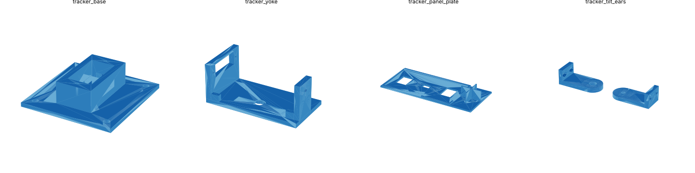
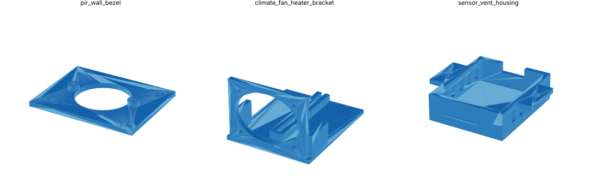

# 3D-printed parts

Seven parts, all generated from one parametric script (`src/make_parts.py`). Change a number at the top of the script and re-run it to regenerate the STLs:

```bash
pip install manifold3d trimesh
python3 src/make_parts.py stl            # writes stl/*.stl
python3 src/make_parts.py stl --check    # also runs the tracker tilt-sweep collision check
```

All dimensions are in mm. Total print volume is about 90 cm³ (~115 g of filament).

| Part | What it does | Material | Print orientation / supports |
|---|---|---|---|
| `tracker_base.stl` | Holds the pan (azimuth) MG90S upright; screws to the roof or mast | PLA | Flat on bed, no supports |
| `tracker_yoke.stl` | Sits on the pan servo horn; left arm carries the tilt MG90S, right arm is the M3 pivot | PLA | Base flat on bed, no supports (servo window bridges 23 mm) |
| `tracker_panel_plate.stl` | Tray for the 110 × 60 mm panel, plus the 4-LDR seat with a cross-shaped shade divider | PLA | Flat on bed, no supports |
| `tracker_tilt_ears.stl` | Two ears that bolt under the plate: left one takes the tilt servo's single-arm horn, right one the M3 pivot | PLA | As exported (outer face down), no supports |
| `pir_wall_bezel.stl` | Mounts an HC-SR501 behind a 24 mm hole in a wall; dome pokes through | PLA | Flat on bed (countersunk face down), no supports |
| `climate_fan_heater_bracket.stl` | Holds the 40 mm fan; the heater plate stands edge-on in a groove in front of it so air washes both sides | **PETG** (sits next to the heater; KSD9700 opens at 50 °C, PLA softens near 55 °C) | Foot flat on bed, no supports |
| `sensor_vent_housing.stl` | Slotted cradle for the BME680 or SHT40 (inner 26 × 32 × 12 mm), screwed to a wall with its open side against the wall | PLA | Open side **down** on the bed, no supports |

Suggested slicer settings: 0.2 mm layers, 3 walls, 25–40 % infill (tracker parts 40 %).




## Hardware

| Where | Fasteners |
|---|---|
| Pan servo → base | 2 × M2 self-tapping (in the servo bag) |
| Base → roof/mast | 4 × M3 or #4 wood screws |
| Pan horn → yoke underside | Double-arm horn in the pocket, 2 × M2 self-tapping through the horn's outer holes; horn screw goes in through the 6 mm hole in the yoke |
| Tilt servo → yoke left arm | 2 × M2 self-tapping; servo body outside the arm, shaft pointing inward |
| Single-arm horn → left ear | Horn in the slot, 2 × M2 self-tapping; horn screw through the 6 mm hole |
| Ears → plate | 4 × M3 × 8 from the top + 4 M3 nuts (hex traps in the ear feet) |
| Pivot (right arm ↔ right ear) | 1 × M3 × 12 + nyloc nut + 2 washers |
| Panel → plate | Double-sided foam tape (rim keeps it located) |
| LDRs | Leads through the 1.1 mm holes, heads in the 5 mm seats, solder underneath, dab of hot glue |
| PIR → bezel | 2 × M2 × 6 self-tapping; bezel → wall 4 × #4 countersunk wood screws |
| Fan → bracket | 4 × M3 × 16 + nuts; bracket → floor 2 × #4 wood screws |
| Heater plate | Edge-on in the 2.2 mm groove, Kapton tape to the rail; KSD9700 taped/epoxied to the plate |
| Sensor housing → wall | 2 × #4 wood screws |

Steel M3 screws (8, 12, 16 mm), M3 nuts/nylocs/washers and #4 wood screws are not on the electronics order: get them from the lab or with the house materials.

## Tracker geometry and limits

- Tilt axis is 29 mm above the yoke's underside and 26 mm below the plate's underside. The check in `make_parts.py --check` sweeps the plate (with ears) from −75° to +75° against the yoke and a model of the tilt servo: **no contact anywhere in that range.** Keep the firmware tilt limit at about ±65° from level for margin.
- The LDR quad sits 75 mm from the tilt axis at the +x end of the plate, outside the panel's shadow. The divider walls are 22 mm tall: Weissbach & Aunkst found a "blinder" raised the left/right difference from 0.9 % to 7.9 % at 10° off-sun.
- Wire paths: pan servo wire exits through the slot in the base; panel leads go through the 12 × 8 mm hole in the plate centre.

## Fit to check on the first print

The servo numbers are typical MG90S datasheet values (body 22.8 × 12.4 mm, tab underside 15.9 mm from the bottom, tab holes 27.8 mm apart, horn face 29.5 mm from the bottom). **Print `tracker_base` first and test the servo fit** before printing the rest. If it's tight or loose, change `CLR` or the `SERVO_*` values and regenerate. If the tilt horn sits deeper or shallower than modelled, shim the right-hand pivot with an extra washer.

## Sources considered

- OYINDAMOLA5 Edge-AI Dual-Axis Solar Tracker `Pan_Tilt_Bracket.stl` (CC BY 4.0): rejected; it's a 120-triangle block model sized for MG996R servos with no servo pockets or holes.
- Hackster "Pan & Tilt Assembly for MG90S Servos" (TheSmallWonder): a good off-the-shelf pan/tilt head if you prefer it, but no license is posted and it has no panel plate or LDR divider.
- Shade divider: R. Weissbach and I. Aunkst, "A microcontroller based solar panel tracking system," ASEE 2007 (research/references.md [19]).
